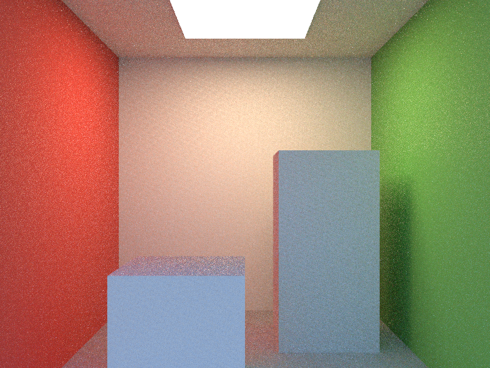
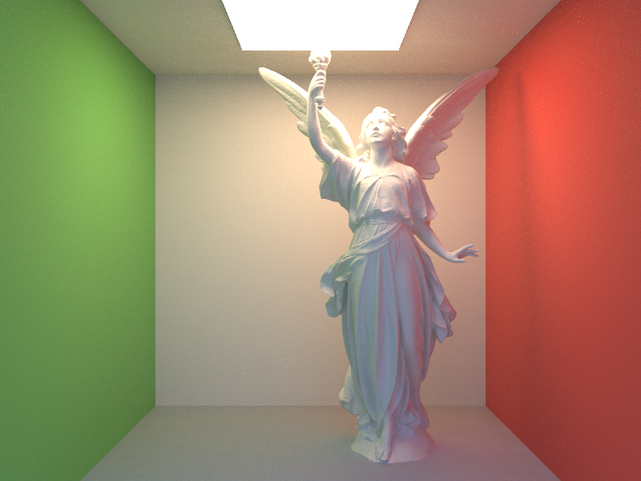
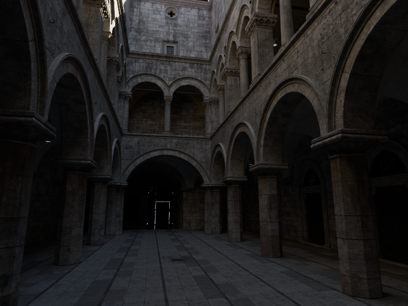
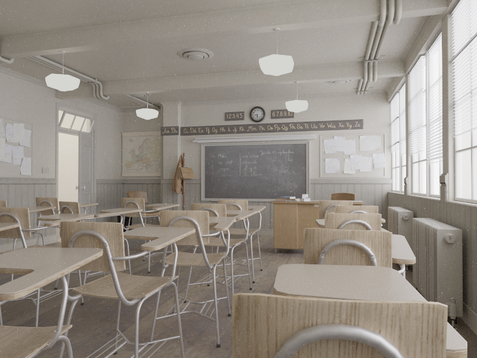
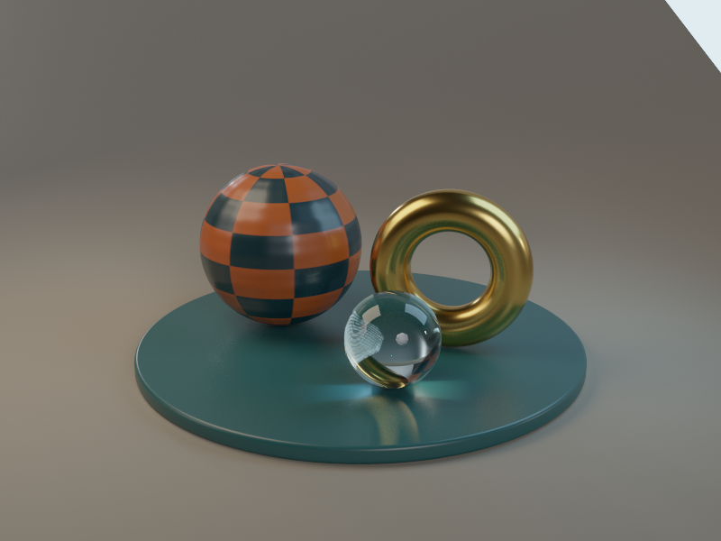
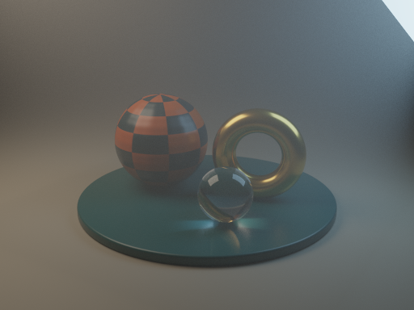
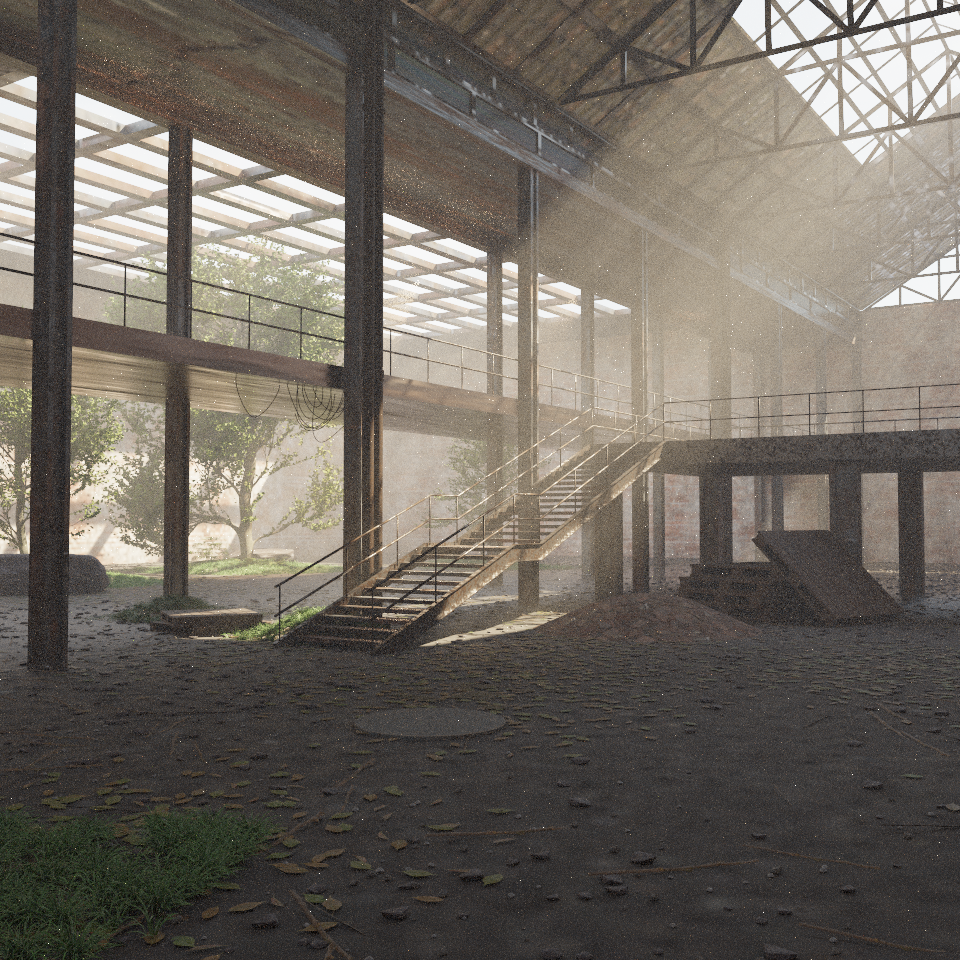
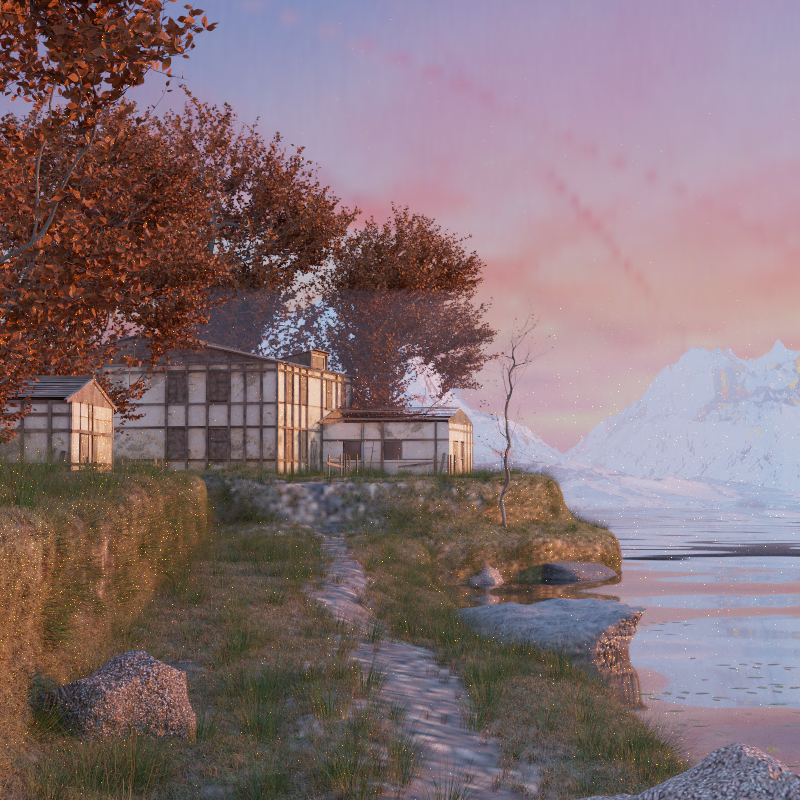

# Xenon

A C++20 path tracer that grew from a sphere on the CPU to textured, multi-million-triangle scenes on NVIDIA RTX hardware.

**CPU · CUDA · OptiX** &nbsp; [Gallery](docs/renders/README.md) · [Benchmarks](docs/QUALIFICATION.md) · [Documentation](docs/README.md)

## Install and run

Linux / WSL, with a C++20 compiler and CMake 3.20+. On Ubuntu:

```sh
sudo apt install build-essential cmake pkg-config libglfw3-dev libgl1-mesa-dev python3 git
git clone https://github.com/Tethane/Xenon.git
cd Xenon
./xenon.sh --scene prim_types --backend cpu --samples 64
```

The launcher builds Xenon and opens a progressive preview. This first scene needs no downloaded assets. Add `--no-display` to render headlessly; images go to `renders/`.

For GPU rendering, install the NVIDIA driver and CUDA Toolkit, make `nvcc` available, and select `--backend cuda` or `--backend optix`. CMake fetches the pinned OptiX headers. [Build options and WSL setup →](docs/GETTING_STARTED.md)

```sh
# Original scenes, with their mesh assets restored
./xenon.sh --scene lucy --backend optix --samples 512

# Exported benchmarks, after the one-time scene setup
./xenon.sh --scene sponza --backend optix --samples 1024
./xenon.sh --scene classroom --backend optix --samples 1024

./xenon.sh --list-scenes
```

[Scene setup and Blender import →](docs/BLENDER_IMPORT.md) · [Original mesh assets →](docs/GETTING_STARTED.md#scenes-and-assets)

## Bring your own scene

Download a `.blend`, glTF/GLB or OBJ with its textures, then export and render:

```sh
python3 scripts/import_scene.py /path/to/scene.blend \
  --output build/imports/my-scene --width 960 --height 540
./xenon.sh --scene build/imports/my-scene/scene.xenon \
  --backend optix --samples 1024
```

Use a compatible Blender installation on `PATH`, set `BLENDER`, or pass `--blender /path/to/blender`. Mesh instances remain shared. Strict export reports unsupported content; `--prepare` is an explicit, reported conversion for selected legacy materials. Check a preview before increasing samples.

[Download → import → render walkthrough](docs/IMPORTING_SCENES.md) covers Blendkit assets, Blender exports, standalone models, textures and grass preparation.

For Blendkit, the downloader accepts a gallery URL or asset ID and keeps the original scene, license metadata and checksum together:

```sh
python3 scripts/download_blendkit.py fea95d8b-bb8d-4bdd-bd53-e1a6252fa3b7 \
  --output build/assets/blendkit/laundromat
python3 scripts/import_scene.py build/assets/blendkit/laundromat/source.blend \
  --output build/imports/blendkit/laundromat --prepare --bake-world \
  --bake-size 512 --compensated-materials --omit-area-lights --omit-object Plane.011 \
  --width 960 --height 540
./xenon.sh --scene build/imports/blendkit/laundromat/scene.xenon \
  --backend optix --samples 1024
```

[The three Blendkit scenes](docs/BLENDKIT_SCENES.md) have their own reproduction commands and conversion notes. Export destinations must be new or empty. For a downloaded object, replace `scene.blend` above with `model.glb` or `model.obj`; the importer uses an available camera or frames the model, then adds a daylight rig. To control the composition and lighting yourself, set them in Blender and import the saved `.blend`.

Grass and trees made from scattered meshes export as triangle instances, including supported Geometry Nodes and particle instances. Raw hair strands need conversion to mesh ribbons or tubes. Preparation records material, lighting and volume approximations alongside the export.

## From a sphere to full scenes

| Cornell box · early CPU render | Lucy · the first dense mesh |
|---|---|
|  |  |

The project started with intersections and a sphere. A Cornell box made indirect light and color bleeding visible; Lucy brought mesh loading and acceleration structures into focus. CUDA moved path tracing into a wavefront pipeline. OptiX now accelerates its intersection queries while Xenon retains control of materials, lighting and transport.

Returning to the project a year later meant revisiting those foundations with more experience. The approach stayed concrete: test the equations, profile the work, then render real scenes and compare linear images with Blender.

| Intel Sponza · 3.75M placed triangles | Classroom · 896 mesh placements |
|---|---|
|  |  |
|  |  |

These benchmark and studio renders use 4,096–8,192 samples, without denoising or radiance clamping. The early images are preserved as project history. [Full gallery and Cycles comparisons →](docs/renders/README.md)

### Downloaded Blender scenes

| Forgotten Industrial Warehouse | Autumn Cabins by the Lake |
|---|---|
|  |  |

Real downloaded scenes, rendered with OptiX at 2,048 samples. Their grass and trees use shared triangle meshes. [Japanese Laundromat](docs/renders/gallery/blendkit-laundromat.png) adds a textured interior at 4,096 samples. Material conversions, reduced texture sizes and Autumn's homogeneous fog approximation are recorded in the [scene recipes and results](docs/BLENDKIT_SCENES.md).

## What it renders

Textured meshes and affine instances; normal, bump and opacity maps; rough metals and glass; compensated GGX, rough diffuse and approximate clearcoat; HDR environments, mesh emitters, point/spot lights and sun; absorbing glass, homogeneous fog, and finite-aperture depth of field.

Blender exports evaluated geometry into an explicit scene contract, with glTF/GLB/OBJ import through Blender. Supported material graphs are documented; procedural inputs may need baking. Arbitrary Blender shaders, hair strands and heterogeneous volumes need further work. [Import scope →](docs/BLENDER_IMPORT.md) · [Material model →](docs/MATERIAL_ENERGY.md)

## Performance

RTX 4060 Laptop GPU, 800×600, 128 samples. Median of three measured runs after warmup:

| Scene | CPU render | CUDA render | OptiX render | OptiX / CUDA speedup |
|---|---:|---:|---:|---:|
| Classroom | 141.71 s | 44.73 s | **3.81 s** | **11.74×** |
| Sponza | 170.73 s | 48.79 s | **6.47 s** | **7.54×** |

Including loading, building, upload and teardown, the gains are **2.75×** and **1.62×** respectively. Across five scenes, linear comparisons against independently sampled Cycles references measured **1.69–5.29% relative RMSE** at the gallery sample counts. Classroom uses a documented shared-source conversion. [Full measurements, timing ranges and commands →](docs/QUALIFICATION.md)

## Under the hood

Each pixel begins with a sampled camera ray. At a surface, Xenon evaluates the material, samples a light and chooses the next direction from the BSDF. Multiple importance sampling balances light and BSDF samples; Russian roulette ends low-contribution paths without a fixed energy cutoff. In fog, sampled scattering events compete with the next surface intersection. Samples accumulate in linear radiance before exposure and display conversion.

- **Tiled CPU, wavefront GPU.** CPU paths run through a worker pool; CUDA separates generation, intersection, shading and shadow work into queues.
- **Shared geometry, separate traversal.** BLAS/TLAS and OptiX GAS/IAS reuse meshes across affine instances. Software CUDA remains a reference for the hardware traversal path.
- **Explicit transport.** Next-event estimation, power-heuristic MIS and Russian roulette combine surface and volume sampling. Device queue counts avoid unnecessary host readbacks.
- **Measurable output.** Seeded paths, linear float32 images and stage timings support analytic tests and renderer comparisons. The backend configuration passes 41 tests; CPU-only, OpenGL and sanitizer checks are recorded separately.

OptiX supplies hardware traversal and hit information. Xenon's CUDA kernels still handle textures, BSDF evaluation, light sampling, medium transport and path continuation. This separation lets the software and hardware traversal backends exercise the same rendering model. Blender is an offline import step; the renderer consumes explicit meshes, instances, materials, lights and volume bounds without requiring Blender at render time.

[`src/`](src/) renderer · [`scenes/`](scenes/README.md) inputs · [`scripts/`](scripts/README.md) asset and measurement tools · [`tests/`](tests/) regressions · [`docs/`](docs/README.md) guides and evidence

[Development and formatting](docs/DEVELOPMENT.md)

Scene credits: Classroom by Christophe Seux; Sponza by Frank Meinl and Anton Kaplanyan, Intel Sample Library; Studio Small 09 by Poly Haven; Japanese Laundromat by 3dhub; Warehouse and Autumn Cabins by Ibrohim Toxirov. [Sources and licenses](docs/ASSETS.md).
