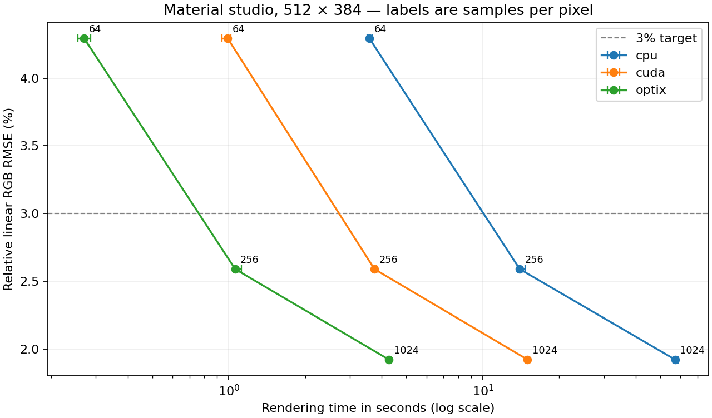

# Real-scene qualification

Measured on 2026-10-12 with an NVIDIA GeForce RTX 4060 Laptop GPU (8 GB), AMD Ryzen AI 9 HX 370, and Linux under WSL. Xenon used a Release build, GCC 13.3, CUDA architecture 89 and OptiX 9 headers. The Windows driver reports 592.00; the isolated Linux OptiX runtime is 590.48.01. [Runtime setup](OPTIX.md) and the individual JSON reports record the build and runtime candidates.

The renderer executable SHA-256 is `90510fa2fb988c8bdb88bbffd5d3a95b4f9fc3da70d016170c182a5afae4bd86`. Every final run uses this executable. Binary and referenced asset hashes are checked before and after each benchmark. Large source assets and float32 PFM files remain under `build/`; the PNGs and complete JSON reports linked here are retained in the repository.

## Images and linear comparison

These are actual Xenon renders, without denoising, adaptive sampling, or radiance clamping. Xenon uses seed 42 and bounce settings 3/8; the minimum controls Russian roulette, and paths can terminate earlier. Independently sampled Blender 4.5.3 Cycles references use seed 1, a Box pixel filter and eight maximum bounces: 1,024 samples except Sponza's 4,096. Both images in every comparison figure use the same exposure, Reinhard tone mapping and sRGB conversion. Error metrics are calculated **before** that transform, directly from scene-linear Rec.709 RGB.

| Scene | Resolution | Xenon samples | Relative linear RMSE | Mean luminance bias | Image / comparison / raw report |
|---|---:|---:|---:|---:|---|
| Material studio | 512×384 | 4,096 | 1.686% | +1.415% | [Render](renders/gallery/material_studio.png) · [Comparison](renders/comparisons/material_studio-comparison.png) · [JSON](qualification/material_studio-beauty.json) |
| HDR studio | 512×384 | 4,096 | 2.146% | +0.641% | [Render](renders/gallery/hdr_studio.png) · [Comparison](renders/comparisons/hdr_studio-comparison.png) · [JSON](qualification/hdr_studio-beauty.json) |
| Glass, fog and finite aperture | 512×384 | 8,192 | 1.818% | +1.113% | [Render](renders/gallery/glass_fog.png) · [Comparison](renders/comparisons/glass_fog-comparison.png) · [JSON](qualification/glass_fog-beauty.json) |
| Converted Classroom | 800×600 | 8,192 | 5.285% | +3.587% | [Render](renders/gallery/classroom-instances.png) · [Comparison](renders/comparisons/classroom-instances-comparison.png) · [JSON](qualification/classroom-instances-beauty.json) |
| Intel Sponza | 800×600 | 8,192 | 4.788% | +2.870% | [Render](renders/gallery/sponza-full.png) · [Comparison](renders/comparisons/sponza-full-comparison.png) · [JSON](qualification/sponza-full-beauty.json) |

Relative RMSE is RGB RMSE divided by the reference RGB root-mean-square magnitude. Mean bias uses Rec.709 luminance weights. These are measured discrepancies, not tolerances that establish exact physical correctness. They include noise in **both** images, differing material models, tangent frames and path termination. High-sample Classroom still contains bright-path noise. Not every residual pixel error has been isolated to a single cause.


Classroom preserves 896 mesh placements, 334 shared mesh assets, 354,728 unique triangles and 607,488 placed triangles. The common `comparison.blend` explicitly converts legacy closures, bakes selected base-color graphs, and changes unsupported light/camera settings. Both renderers use this converted source; this does not reproduce the original Classroom shading.


Sponza preserves 115 placements, 95 shared mesh assets and 3,747,004 placed triangles, including fractional-alpha dirt decals. Blender removes 14 duplicate indexed faces from the original glTF. Texture dimensions are capped at 1,024 in the shared source for this benchmark. Its authored camera, common sun/world rig and +4 EV display exposure are identical between comparisons; exposure never changes the linear measurements.

| Native material study | Homogeneous fog and depth of field |
|---|---|
|  |  |

The [native material study](qualification/energy_studio-beauty.json) is 800×600 at 8,192 samples. It deliberately adds EON rough diffuse, approximate clearcoat and glass absorption to the HDR studio. It is a separate appearance study, **not a matched Cycles comparison**. [Reproduce those materials](MATERIAL_ENERGY.md#native-material-study).

## Repeated performance measurements

The five-scene suite uses 128 samples at the resolutions above, one discarded warmup and three measured runs per backend, interleaved to reduce order effects. CPU, software CUDA and OptiX use identical inputs and requested settings. No other renders run concurrently. Render time excludes startup; full process wall time includes loading, acceleration structures, GPU setup/upload, rendering, image/JSON output and teardown. The renderer's `seconds.total` stops after image output and is labelled separately in raw data.

Median [minimum–maximum] across three measured runs. Every scene name links to its complete report.

| Scene | CPU render seconds | CUDA render seconds | OptiX render seconds | OptiX vs CUDA |
|---|---:|---:|---:|---:|
| [Material studio](qualification/material_studio-benchmark.json) | 7.214 [7.138–7.322] | 1.909 [1.855–1.968] | 0.535 [0.527–0.588] | 3.57× |
| [HDR studio](qualification/hdr_studio-benchmark.json) | 9.559 [9.486–9.560] | 2.327 [2.278–2.355] | 0.628 [0.601–0.659] | 3.71× |
| [Glass / fog](qualification/glass_fog-benchmark.json) | 8.361 [8.306–8.372] | 2.426 [2.416–2.465] | 0.635 [0.594–0.652] | 3.82× |
| [Classroom](qualification/classroom-instances-benchmark.json) | 141.705 [138.898–141.774] | 44.735 [44.729–44.857] | 3.810 [3.807–3.849] | 11.74× |
| [Sponza](qualification/sponza-full-benchmark.json) | 170.732 [167.892–177.819] | 48.789 [48.725–48.949] | 6.468 [6.451–6.521] | 7.54× |

| Scene | CPU process seconds | CUDA process seconds | OptiX process seconds | OptiX vs CUDA |
|---|---:|---:|---:|---:|
| [Material studio](qualification/material_studio-benchmark.json) | 7.452 [7.365–7.556] | 2.709 [2.573–2.769] | 1.625 [1.578–1.700] | 1.67× |
| [HDR studio](qualification/hdr_studio-benchmark.json) | 9.847 [9.780–9.865] | 3.178 [3.046–3.188] | 1.814 [1.779–1.883] | 1.75× |
| [Glass / fog](qualification/glass_fog-benchmark.json) | 8.612 [8.558–8.628] | 3.216 [3.198–3.236] | 1.758 [1.714–1.851] | 1.83× |
| [Classroom](qualification/classroom-instances-benchmark.json) | 153.358 [150.770–154.069] | 64.318 [63.547–64.957] | 23.373 [22.932–23.661] | 2.75× |
| [Sponza](qualification/sponza-full-benchmark.json) | 225.137 [220.870–229.305] | 112.975 [110.939–113.672] | 69.630 [67.140–75.163] | 1.62× |

Sponza's OptiX run spends a median 50.29 seconds loading and 7.05 seconds uploading, compared with 6.47 seconds rendering and 0.52 seconds building OptiX acceleration structures. Startup limits the full-process gain. These are warm-cache, scene-specific laptop measurements, not universal ratios.

| Scene, 128 samples | CUDA / CPU relative RMSE | OptiX / CPU relative RMSE | OptiX / CPU mean bias |
|---|---:|---:|---:|
| Material studio | 0.0002% | 0.0137% | -0.0001% |
| HDR studio | 0.0036% | 0.0215% | -0.0000% |
| Glass / fog | 0.0090% | 0.0293% | -0.0000% |
| Classroom | 1.9584% | 3.1637% | -0.0116% |
| Sponza | 0.6996% | 1.4705% | -0.0230% |

All backend errors are untrimmed. Classroom has sparse bright-path differences: in the [same-seed diagnostic](qualification/classroom-backend-audit.json), ten pixels account for 94% of CPU–OptiX squared error, while mean brightness differs by only 0.012%. This is consistent with floating-point intersection/path divergence; one seed does not establish unbiased equivalence. The [repeated-image audit](qualification/repeat-image-audit.json) also records fixed-seed stability. The [suite report](qualification/suite-results.json) retains all reference metadata and provenance links.

The earlier [controlled scheduling experiment](OPTIX_PERFORMANCE.md) isolates device queue counters and traversal changes using its own frozen executable. It is separate from these final-feature measurements. Host-side CUDA synchronization duration includes waiting for GPU execution and is not equated with overhead.

## Time to a tested image error

The material studio is also measured at 64, 256 and 1,024 samples, with the same repetitions and independent Cycles reference. The target is 3% relative linear RMSE. Time to target is the first tested sample level meeting it; there is no interpolation or guarantee for other scenes.

| Backend | Samples | Relative linear RMSE | Render seconds, median [range] | Process seconds, median [range] |
|---|---:|---:|---:|---:|
| cpu | 64 | 4.294% | 3.574 [3.508–3.674] | 3.843 [3.772–3.925] |
| cpu | 256 | 2.589% | 13.979 [13.746–14.679] | 14.223 [14.020–14.941] |
| cpu | 1024 | 1.922% | 57.126 [56.071–58.820] | 57.354 [56.317–59.082] |
| cuda | 64 | 4.294% | 0.989 [0.939–1.020] | 1.725 [1.656–1.780] |
| cuda | 256 | 2.589% | 3.745 [3.739–3.813] | 4.662 [4.528–6.456] |
| cuda | 1024 | 1.922% | 14.985 [14.892–15.017] | 15.828 [15.725–17.679] |
| optix | 64 | 4.294% | 0.269 [0.255–0.285] | 1.359 [1.333–1.372] |
| optix | 256 | 2.589% | 1.060 [1.059–1.120] | 2.136 [2.109–4.339] |
| optix | 1024 | 1.922% | 4.266 [4.260–4.304] | 5.386 [5.369–7.415] |

First tested pass: cpu: 256 samples, 13.979 s rendering / 14.223 s full process; cuda: 256 samples, 3.745 s rendering / 4.662 s full process; optix: 256 samples, 1.060 s rendering / 2.136 s full process.



Error bars show measured minimum and maximum times; lines connect only tested sample levels. [Raw quality/time measurements](qualification/quality-curve.json). The independent reference has finite samples and a different BSDF implementation, so more samples do not guarantee zero error.

## Validation and supported scope

The [full backend configuration](qualification/ctest-cuda-optix.log) passes 41 tests, the [CPU-only configuration](qualification/ctest-cpu.log) passes 22, and the [actual OpenGL framebuffer check](qualification/ctest-opengl.log) passes using software OpenGL. These overlapping configurations are not 64 unique tests. An earlier [targeted ASan/UBSan run](qualification/sanitizer-targeted.log) passes five tests; the repaired thread pool additionally passes [ASan](qualification/thread-pool-asan.log) and [TSan](qualification/thread-pool-tsan-noaslr.log). Blender exporter/import integration regressions and manifest preflight also pass.

Tests include independent analytic light and volume integrals, Beer–Lambert attenuation, phase distributions, BSDF energy/reciprocity/PDF checks, finite-aperture sampling, affine instances, texture orientation/color spaces, opacity coverage and two-sided emission. Real-scene validation caught and corrected two additional issues: Cycles mesh emitters radiate from both sides, and the earlier seed mapping produced spatially correlated noise. [Sampling evidence](SAMPLING.md) records the correction. Earlier diagnostic beauty renders are superseded and excluded from these results.

The [feature coverage matrix](IMPLEMENTATION_STATUS.md), [scene contract](SCENE_CONTRACT.md), [material limits](MATERIAL_ENERGY.md), and [Blender workflow](BLENDER_IMPORT.md) define the supported scope. Compensated GGX is an approximation to opaque Cycles MULTI_GGX; transmission retains Xenon's single-scattering model. Clearcoat is approximate. Tangents use triangle UV derivatives rather than MikkTSpace, texture LOD is explicit, volumes are nonoverlapping homogeneous boxes, and glass interfaces retain the air/material IOR convention. Arbitrary Blender graphs, heterogeneous volumes, true subsurface transport, sheen, motion blur, EXR/UDIM inputs and native displacement are not implemented. Strict export checks supported material and object types; reported conversions save a separate shared source. Scatter density and legacy hair need the [additional preparation described in the import guide](BLENDER_IMPORT.md#blendkit-scenes-and-grass).

## Reproduce

Set up [checksummed assets](ASSETS.md), follow the [complete five-scene source/reference commands](BLENDER_IMPORT.md#reproduce-the-final-five-scene-suite), and build with CUDA/OptiX enabled. On this WSL setup, prepend the documented isolated runtime directory:

```sh
export LD_LIBRARY_PATH="$PWD/build/optix-runtime:/usr/lib/wsl/lib${LD_LIBRARY_PATH:+:$LD_LIBRARY_PATH}"
python3 scripts/qualify_scenes.py --binary build/optix/xenon \
  --samples 128 --repeats 3 --warmups 1 --output-dir build/qualification/final

python3 scripts/benchmark.py build/fixtures/material_studio-compensated/scene.xenon \
  --binary build/optix/xenon --backends cpu cuda optix \
  --width 512 --height 384 --sample-levels 64 256 1024 \
  --min-bounces 3 --max-bounces 8 --seed 42 --repeats 3 --warmups 1 \
  --reference build/fixtures/material_studio/cycles.pfm --target-error .03 \
  --output-dir build/qualification/quality-curve

# High-sample matched gallery; same settings as the table above.
python3 scripts/qualify_scenes.py --binary build/optix/xenon --backends optix \
  --scenes material_studio hdr_studio --samples 4096 --repeats 1 --warmups 0 \
  --output-dir build/qualification/gallery-4096
python3 scripts/qualify_scenes.py --binary build/optix/xenon --backends optix \
  --scenes glass_fog classroom-instances sponza-full --samples 8192 \
  --repeats 1 --warmups 0 --output-dir build/qualification/gallery-8192
```

Credits: Classroom by Christophe Seux (CC0); Intel Sponza commissioned by Frank Meinl, sponsored by Anton Kaplanyan, Intel Sample Library (2022), with its [complete distributed license/notice](licenses/Sponza.txt); Studio Small 09 HDRI by Poly Haven (CC0). The studio geometry and maps are generated by repository scripts. [Download URLs and checksums](ASSETS.md) retain the asset provenance.
