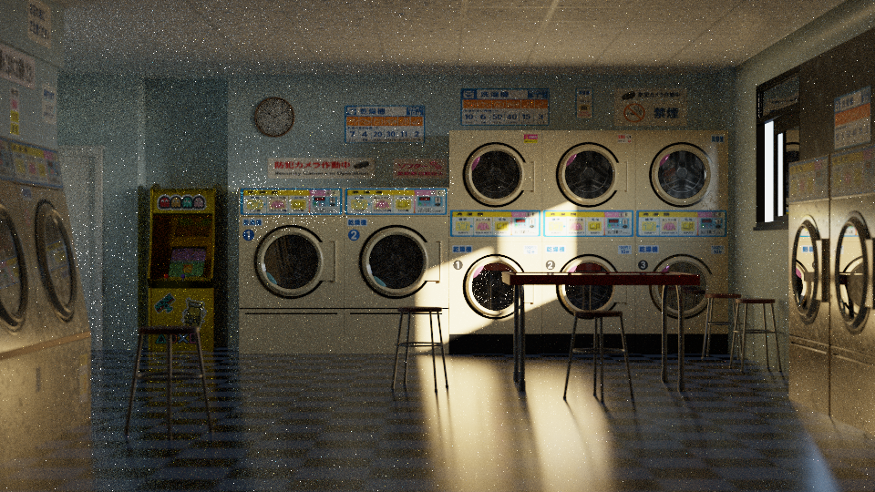
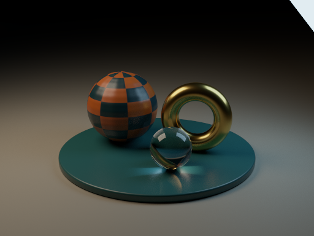
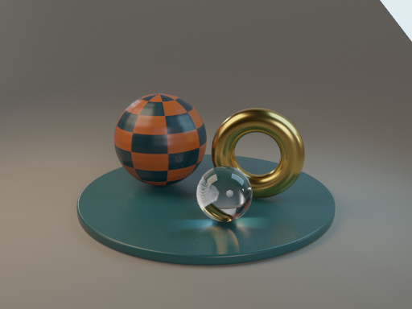

# Render gallery

## Downloaded Blender scenes

| Forgotten Industrial Warehouse | Autumn Cabins by the Lake |
|---|---|
|  |  |

Japanese Laundromat by 3dhub; Warehouse and Autumn Cabins by Ibrohim Toxirov. Rendered by Xenon with OptiX, without denoising or radiance clamping. These are explicit scene conversions, including material baking, texture resizing and an approximation of Autumn's fog.

[Settings, geometry counts and reproduction](../BLENDKIT_SCENES.md) · [Render records and checksums](blendkit-results.json) · [Asset credits](../ASSETS.md)

## Benchmark and studio renders

| Intel Sponza | Converted Classroom |
|---|---|
|  |  |
|  |  |
|  |  |

Rendered by Xenon with OptiX, without denoising or radiance clamping. Sponza, Classroom and the material study are 800×600 at 8,192 samples. Fog is 512×384 at 8,192; the two remaining studios are 512×384 at 4,096.

[Settings, measurements and reproduction](../QUALIFICATION.md) · [Asset credits](../ASSETS.md) · [Sponza license](../licenses/Sponza.txt)

## Cycles comparisons

Each figure shows Xenon, the independently sampled Cycles reference and linear image error. Both displayed images use the same exposure and transform. The native material study intentionally changes materials and has no matched reference.

[Material studio](comparisons/material_studio-comparison.png) · [HDR studio](comparisons/hdr_studio-comparison.png) · [Glass and fog](comparisons/glass_fog-comparison.png) · [Classroom](comparisons/classroom-instances-comparison.png) · [Sponza](comparisons/sponza-full-comparison.png)

[Image error versus rendering time](plots/quality-curve.png)

## Early renders

These original images document the project's progression. They predate the current renderer and are retained unchanged, including their original noise and display behavior.

| Cornell box | Lucy |
|---|---|
|  |  |

[Cow](history/cow.png) · [Cow variant](history/cow-variant.png) · [Instancing grid](history/instancing_grid.png) · [Primitives](history/prim_types.png) · [Sky dome](history/sky_dome.png) · [Combined outdoor](history/combined_outdoor.png)
